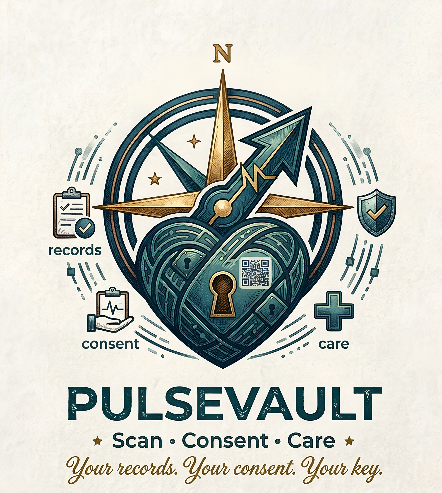
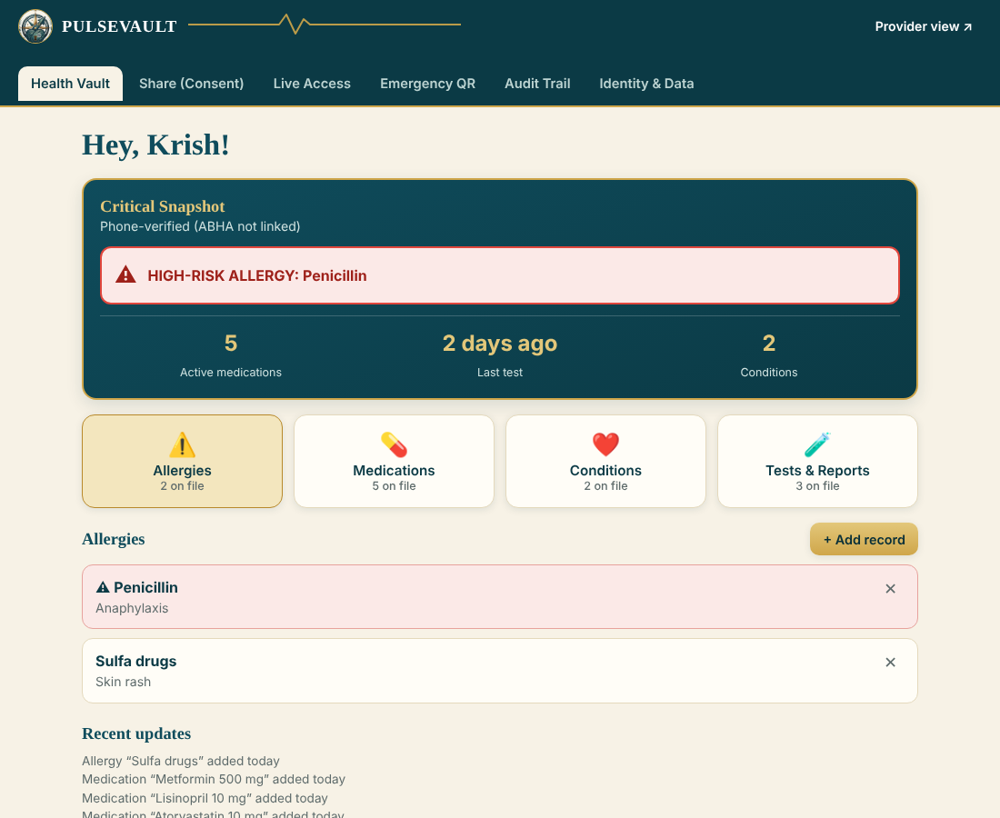
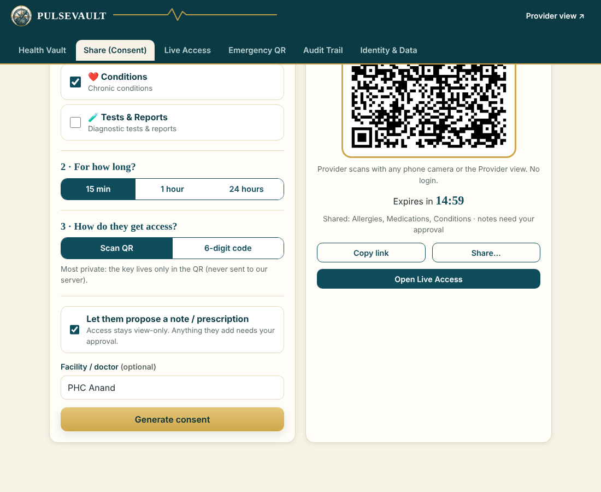
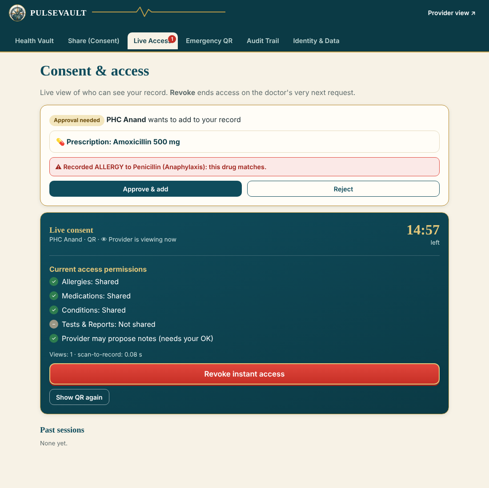
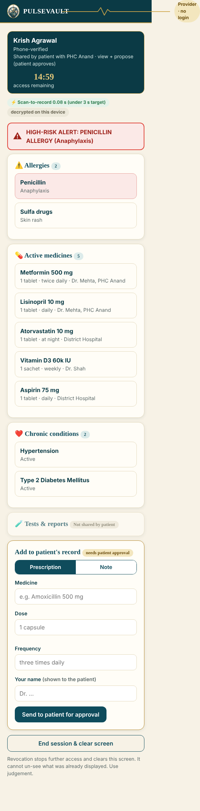
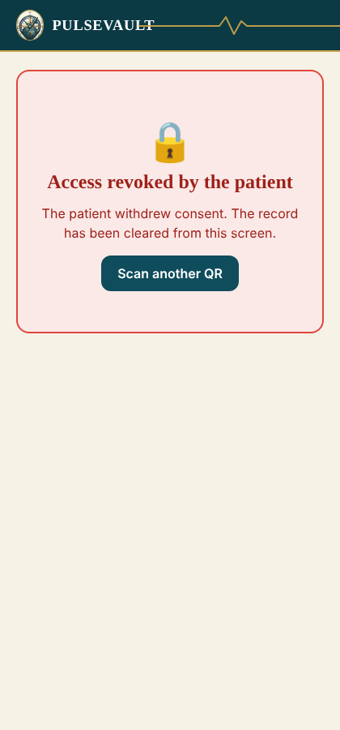
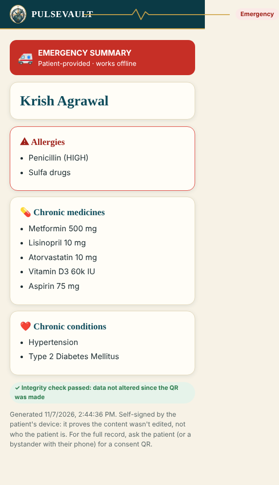

<p align="center"></p>

# PulseVault

**Your records. Your consent. Your key.**
An ABHA-linked, QR-based, consent-driven health vault. Patients carry their own record, providers see critical history in seconds with no login, and consent is scoped, time-bound and revocable in one tap.

Built as my personal project and also for the submission in contests.  
Krish Agrawal · Dr. S. & S.S. Ghandhy Government Engineering College, Surat.

**Live demo:** https://pulsevault-web.netlify.app

| Patient vault | Consent QR | Live access + revoke |
|---|---|---|
|  |  |  |

| Provider view (no login) | After revoke | Emergency QR |
|---|---|---|
|  |  |  |

## How it meets the problem statement

| Requirement | What PulseVault does |
|---|---|
| Patient-held record via QR, ABHA, or both | On-device encrypted vault; phone-OTP onboarding with optional ABHA linking (sandbox mock); consent QR |
| Granular, instantly revocable consent | Per-category scope, 15 min / 1 h / 24 h expiry, live status, one-tap **Revoke** that ends access on the provider's next request |
| Provider access in seconds, no login or hardware | `/provider.html`: scan with any camera or type a 6-digit code. Measured scan-to-record time is shown on screen |
| Instant critical history | Critical Snapshot: allergies (high-risk alert), medicines, conditions, tests. Rule-based allergy cross-check on proposed prescriptions |

Also: emergency QR readable offline (ECDSA-signed), hash-chained audit trail, FHIR R4 export, installable PWA with offline shell.

## Pages

| Path | Purpose |
|---|---|
| `/` | Landing page covering the problem, solution, architecture, roadmap |
| `/app.html` | Patient app |
| `/provider.html` | Provider point-of-care view |
| `/emergency.html` | Offline emergency summary (opened from the emergency QR) |
| `/api/*` | Consent / token service (Netlify Function) |

## Architecture and security

```
Patient app (PWA) --encrypt (AES-256-GCM)--> Token service (Netlify Function + Blobs) --ciphertext--> Provider page --decrypt locally
        |                                         signed token, expiry, revoke flag checked on EVERY request
        +-- key travels only in the QR URL fragment (#k=...), which browsers never send to a server
```

- Shared records are encrypted in the patient's browser; the server stores ciphertext only (QR mode).
- Tokens are HMAC-SHA256 signed and short-lived, with a server-side revoke check on every request.
- Revoke deletes the ciphertext; the provider page polls every 2 s and clears itself.
- Audit log is hash-chained; local vault is encrypted at rest with a non-extractable device key.
- Strict CSP, no third-party scripts or CDNs.

## Run locally

```bash
npm install
npm run dev     # http://localhost:8888 (in-memory store)
npm test        # API security tests (20 checks)
```

## Deploy to Netlify

1. Push this repo to GitHub, then in Netlify: **Add new project → Import from Git**. Leave the build command empty; `netlify.toml` supplies the settings.
2. Add the environment variable **`TOKEN_SECRET`** (mark it secret) with a long random value, e.g. `openssl rand -base64 48`.
3. Deploy, then open `/api/health`. You want `"store":"netlify-blobs"` and `"secretSet":true`.

Do not deploy without `TOKEN_SECRET`: the code falls back to a public development key, and tokens would be forgeable.
Camera scanning needs HTTPS, which Netlify provides.

## Honest limits

- Phone OTP and ABHA linking are **demo mocks** (no SMS gateway, no ABDM sandbox credentials). Real ABDM integration needs registration and certification.
- 6-digit-code mode escrows the key on the server for the session's life, a lower-security tier (rate-limited). QR mode is fully zero-knowledge.
- Revoking stops further access; it cannot un-see data already displayed.
- The emergency QR is self-signed: it proves integrity, not identity.
- The allergy check is a small rule table, not clinical decision support. **No ML is used**; none is needed for this problem. All demo data is synthetic.
- The vault lives in the browser: clearing site data loses it (use the FHIR export). A passkey or biometric lock is on the roadmap.
- Prototype only. Not a medical device and not affiliated with NHA/ABDM.

## Repository layout

```
public/            static site (pages, css, js, vendored QR libs, brand assets, service worker)
netlify/functions/ consent / token service
test/              API security tests (api.test.mjs) and browser end-to-end script (e2e.py)
docs/              abstract deck (.pptx), original logo and concept art, screenshots
```

`test/e2e.py` is a Playwright script written against a local Chrome at `/usr/bin/google-chrome`; adjust the path for your machine.

## Credits and licence

MIT licensed (see `LICENSE`). Vendored libraries are listed in `THIRD_PARTY_NOTICES.md`.
